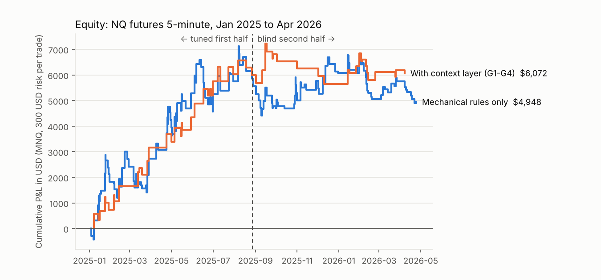
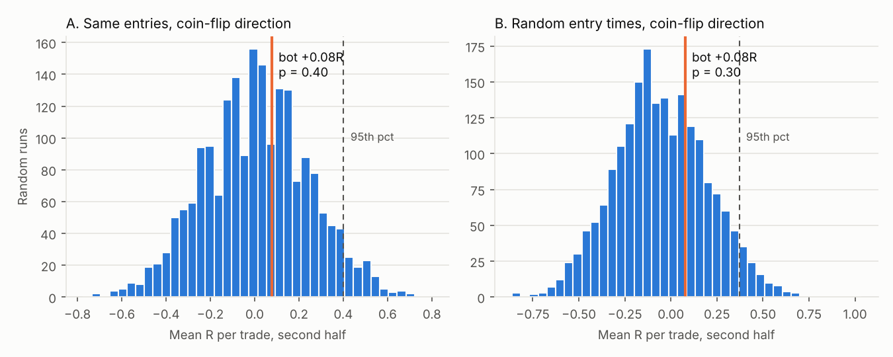

# Backtest report: Structure S/D Day Bot

Source strategy: the "Understanding Price" technical analysis master course (transcript supplied by the user).
Market: NQ futures, 5-minute bars, Jan 1 2025 to Apr 24 2026 (real CME data, 92,201 bars).
Sizing: MNQ ($2/pt), $300 risk per trade, $0.50/contract/side commission, 1 tick slippage on market and stop fills.

**Verdict: FAIL on the coin-flip rule. Paper trade only. Do not run it on a paid eval yet.**

## How it was tested

1. Split the data at the session open on Aug 27 2025. First half = tuning. Second half = blind test.
2. Tuned on the first half only (grid search, best by SQN with at least 30 trades).
3. Locked the parameters and ran them once on the second half.
4. Coin-flip rule, written down before the blind run (`backtest/coinflip.py`). PASS needs all four:
   * at least 30 blind trades
   * blind net profit > 0 after costs
   * beats at least 95% of 10,000 runs that keep the bot's exact entries (same bar, price and moment) but flip a coin for direction
   * beats at least 95% of 2,000 runs that enter at random times in the same session window with a coin-flip direction, using the bot's own stop, target and size

The test simulator reproduces all of the bot's own trades exactly (re-simulated expectancy = actual expectancy), so the random runs are like for like.

## Results

| Run | Half | Trades | Net | Profit factor | Win rate | Avg R | Max DD |
|---|---|---|---|---|---|---|---|
| 1. Mechanical rules only | first (tuned) | 91 | +$5,861 | 1.43 | 40% | +0.26 | $2,017 |
| 1. Mechanical rules only | second (blind) | 73 | **-$914** | 0.90 | 34% | -0.04 | $1,868 |
| 2. + context layer G1-G4 | first (tuned) | 36 | +$5,989 | 2.48 | 56% | +0.62 | $575 |
| 2. + context layer G1-G4 | second (blind) | 25 | **+$83** | 1.02 | 40% | +0.08 | $1,581 |

Coin-flip rule, run 2 (blind half): p = 0.40 against random direction, p = 0.30 against random timing.
Random entries with the same risk management did as well as the bot about a third of the time. **FAIL.**

Note on the blind half: it was used twice. Run 1 (mechanical only) failed. Run 2 added the context layer the user
asked for. Those rules come from the course and the user's brief, not from looking at blind-half trades, but a
second look still makes the blind half a bit less blind. No further tuning was done against it.

## The context layer ("discretionary gap")

Each subjective read from the course became a measurable rule, mirrored line for line in Pine and Python.
Median first-half SQN across all other settings shows what each rule did (higher is better):

| Rule | What it measures | Off | On | Kept |
|---|---|---|---|---|
| G1 pullback quality | correction speed / impulse speed <= 0.6 and efficiency ratio <= 0.7 (slow and choppy) | -0.29 | +0.30 (strict 0.4/0.5: -0.19) | yes, moderate |
| G2 HTF clean structure | HTF made a higher low (buys) / lower high (sells) | -0.23 | +0.30 | yes |
| G2 HTF discount/premium | buy only in the lower half of the HTF leg, sell only in the upper half | n/a | too few trades (< 30 on every setting) | no |
| G3 pre-fill cancel | pull the limit when price is within 1 ATR and closing in at >= 0.5 ATR/bar | -0.02 | -0.06 | no |
| G4 prop drawdown | size so a full stop fits in 90% of the remaining daily loss room, stop after 2 straight losses | always on | | yes |

G3 limit: TradingView strategies decide at bar close, so the "cancel right before fill" check runs on the bar
before the fill (5 minutes), not tick by tick. A true intrabar cancel would need execution on a 1-minute chart.

## Prop-firm risk (run 2)

| | First half | Second half |
|---|---|---|
| Worst day | -$573 (1.1%) | -$318 (0.6%) |
| Days at or below -$1,000 daily limit | 0 | 0 |
| Days at or below a 4% daily drawdown | 0 | 0 |
| Longest losing streak (days) | 2 | 4 |

Eval simulation (Topstep-style 50K: +$3,000 target, $2,000 trailing max loss, 50% consistency), one eval started
on every trading day:

| | Evals | Passed | Failed | Still running at data end | Median days to pass |
|---|---|---|---|---|---|
| First half | 169 | 82 | 0 | 87 | 67 |
| Second half | 170 | 0 | 0 | 170 | none |

The drawdown rules did their job: no eval ever failed. But on new data the bot makes too few trades
(about 3 a month) with too small an edge to reach +$3,000.

## Signal funnel (run 2, full history)

Breaks of structure in the HTF direction that left an imbalance: 878 demand + 705 supply zones.
Zones without an imbalance were dropped (1,610 + 1,284). Taps: 1,011. Killed by a momentum candle: 93.
The context and golden-rule counts below are bar-level vetoes on open limit orders (one zone can be vetoed on
several bars): G1 pullback too aggressive 2,548, G2 HTF not clean 642, golden rule (equal highs/lows) 389.

## What would move it toward a PASS

* More trades per month so the edge can show: add ES/MES and run both, or run execution on 1-minute.
* Forward paper trading: every new week of live paper trades is truly unseen data.
* Re-run `backtest/pipeline.py` as new bars arrive. The gate decides, not the backtest.

Files: `results.json` (all numbers), `trades.csv` (run 2 trades), `trades_run1_mechanical.csv`,
`is_grid.csv` (every first-half parameter set), `coinflip_dist.json`.
